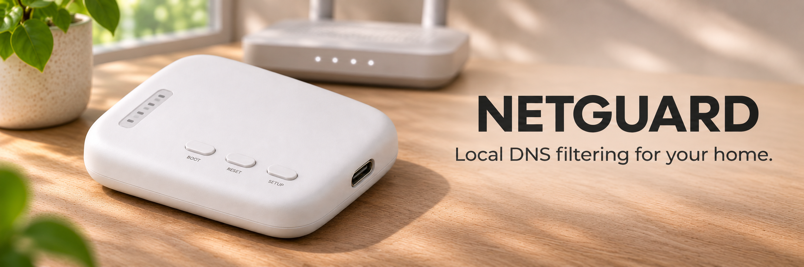
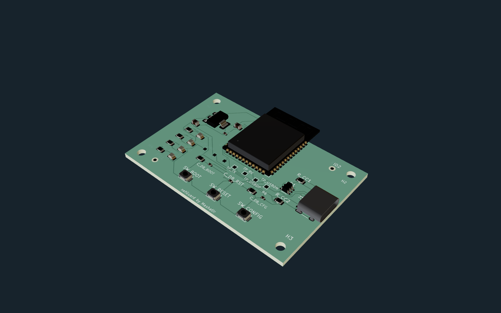

# NetGuard by Mashatir

**A small device. More control over your home network.**

A USB-C-powered, open-source DNS filtering device built around the ESP32-S3.

**Local control · No account · No subscription**

[The idea](#the-idea) · [How it works](#how-it-works) · [Hardware](#hardware) · [Project status](#project-status) · [Contributing](CONTRIBUTING.md)

<em>Enclosure concept render; final hardware design is in progress.</em>

## The idea

NetGuard is designed to give your home network a local DNS filtering device. Configure your router to give its address to your devices, and DNS queries can be checked against your rules before connections are made. Phones, laptops, TVs, consoles, and IoT devices can benefit without installing an app on each one.

The product vision is a pocket-sized device configured with a companion mobile app: Bluetooth for initial setup, then local-network communication. No cloud dashboard, account, or subscription is intended.

### Designed for everyday control

| Feature | Product vision |
| --- | --- |
| **Network-wide filtering** | Block requests to known advertising, tracking, and malware domains. |
| **Your rules** | Block or allow domains and set time-based access rules. |
| **Per-device controls** | Apply rules to devices using their local network addresses. |
| **Blocklist and allowlist modes** | Choose between blocking known domains or allowing only specified domains. |
| **Local setup and control** | Pair over Bluetooth, then use the mobile app on the local network. |
| **Open source** | Share the firmware, hardware designs, and companion app. |

> **Development status:** This table describes the product vision, not a list of features verified in the current firmware. See [Project status](#project-status) before using it as a purchase or deployment guide.

## How it works

1. Configure the router's DHCP settings to give clients NetGuard's local IP address as their DNS server.
2. Client devices send DNS queries directly to NetGuard.
3. NetGuard checks applicable domain rules and schedules; blocked requests receive `NXDOMAIN`.
4. The current firmware forwards permitted queries to upstream resolvers. Fully local DNS resolution is a project goal, **not** a feature of the current firmware.

Per-device rules depend on clients sending DNS directly to NetGuard. If a router proxies DNS queries, requests can appear to come from the router rather than individual devices.

## Hardware

  
  
<em>NetGuard PCB render — enclosure design is in progress.</em>

The board measures **55 × 40 mm** and includes Wi-Fi, Bluetooth, USB-C power, four indicator LEDs, and three physical buttons. Explore the [KiCad PCB layout](hardware/pcb/netguard_compact_r2.kicad_pcb) or the [full-size PCB render](images/netguard_pcb_render.png).

## Project status

NetGuard is being prepared for crowdfunding. The PCB layout is available in this repository; the enclosure and companion mobile app are in progress.

The current firmware includes a DNS filter, global blocks, schedules, per-device profiles, and a local HTTP API. It does not serve a web frontend in the current source tree. Bluetooth provisioning, allowlist mode, and fully local DNS resolution are part of the intended direction and are not implemented here yet. The mobile app and PCB schematic are not included in this repository.

The [v0.1.0 release](release/README.md) predates the current API-only source and includes the earlier dashboard-based firmware. Check the release notes and [flashing guide](docs/FLASHING.md) before flashing.

## Network limits

DNS filtering is not a complete firewall. Manually configured DNS, encrypted DNS, IPv6 DNS, VPNs, proxies, and direct IP connections can bypass it unless the network applies additional controls. Keep the local HTTP API on a trusted network and do not expose it directly to the internet.

## Build and contribute

The firmware is an ESP-IDF project targeting the ESP32-S3. See the [flashing guide](docs/FLASHING.md), [contribution guidelines](CONTRIBUTING.md), and [release history](CHANGELOG.md).

Contributions to firmware, hardware documentation, testing, and the planned mobile experience are welcome.

## License

This repository is available under the [MIT License](LICENSE).

**Built for local control. Designed to be open.**

