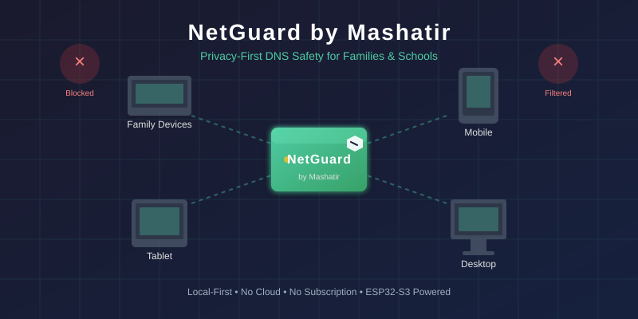
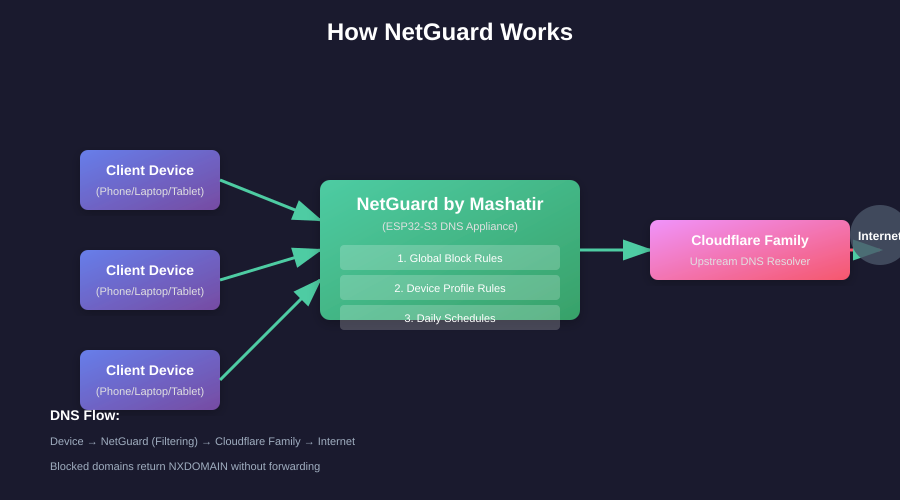

# 🛡️ NetGuard by Mashatir

> **Local-first ESP32-S3 DNS safety for families, schools, and small networks.**

**Private by design · Clear controls · No cloud account · No subscription**

[Features](#-features) · [How it works](#-how-it-works) · [Pre-built device](#-get-a-pre-built-netguard) · [Firmware](#-release-firmware) · [Contributing](CONTRIBUTING.md)

NetGuard is an **ESP32-S3 DNS filter**, **parental-control appliance**, and **family internet safety device**. It applies understandable website rules on your own network, without uploading browsing history or requiring a cloud subscription.

## ✨ Features

| Control | What it does |
| --- | --- |
| Global website blocks | Permanently blocks a domain and its subdomains for every protected device. |
| Daily access windows | Allows a selected domain only during a local-time window, including midnight-crossing windows. |
| Per-device profiles | Adds blocked domains and schedules to up to 16 router-reserved IPv4 addresses. |
| Possible-bypass alerts | Records known VPN, proxy, and encrypted-DNS lookups as signals—not proof of VPN use. |
| Local dashboard | Configures Wi-Fi, policies, counters, and status without a cloud account. |
| Privacy-safe operation | Keeps configuration local; activity counters and recent alerts stay in RAM and reset on reboot. |

## 🔄 How it works

1. Router DHCP gives clients NetGuard’s LAN IP as their DNS server.
2. NetGuard evaluates global blocks, profile blocks, schedules, and possible-bypass indicators.
3. Blocked domains receive `NXDOMAIN`; allowed requests are sent to Cloudflare Family DNS.

**Policy priority:** global permanent blocks → profile blocks → global schedule → profile schedule → upstream DNS. Profile rules can add restrictions but never weaken global rules.

## 🏠 Get a pre-built NetGuard

<table>
  <tr>
    <td width="58%">
      <h3>Plug in. Protect your network. Stay in control.</h3>
      
A ready-to-use NetGuard appliance delivers local DNS safety without assembling hardware or maintaining a cloud dashboard.

      
<strong>Included:</strong> ESP32-S3 hardware, pre-flashed firmware, setup guidance, and a one-year hardware warranty.

      
<a href="mailto:sales@mashatir.com?subject=NetGuard%20pre-built%20device%20order"><strong>🛒 Order a pre-built NetGuard</strong></a> &nbsp;·&nbsp; <a href="mailto:sales@mashatir.com?subject=NetGuard%20school%20or%20bulk%20enquiry"><strong>🏫 School and bulk enquiries</strong></a>

    </td>
    <td width="42%" align="center">
      <h2>NetGuard</h2>
      
<strong>Family DNS safety</strong>

      
✓ Local-first ✓ No subscription ✓ No browsing-history upload ✓ ESP32-S3 powered

    </td>
  </tr>
</table>

## 📦 Release firmware

Current release: **v0.1.0**, for ESP32-S3 boards with **16 MB flash**.

The full-flash image is `release/netguard-v0.1.0-esp32s3-16mb.bin`. Select it in an ESP32 flashing tool and flash at address `0x0`. Follow [docs/FLASHING.md](docs/FLASHING.md) for the safe flashing and verification steps.

## ⚙️ Initial setup

1. Join `NetGuard-Mashatir Setup` after powering on the device.
2. Enter the setup password supplied with the device.
3. Visit `http://192.168.4.1`, create an administrator password, and enter home Wi-Fi details.
4. Reserve NetGuard’s LAN IP, then configure router **LAN DHCP DNS** to give clients that address directly.

Per-device policy requires direct DNS to NetGuard. A router DNS proxy makes requests appear to come from the router instead of individual devices.

## ⚠️ Network limits

DNS filtering is not a complete firewall or an exact screen-time meter. Manual DNS, encrypted DNS, IPv6 DNS, direct IP connections, VPNs, proxies, and Private Relay can bypass DNS-only controls. A possible-bypass alert is a known-provider lookup, not proof of VPN usage. Use compatible router/firewall controls for stronger enforcement.

## 🔐 Security and privacy

- Administrator passwords use salted iterative hashing; state-changing dashboard requests use CSRF protection.
- Sessions, counters, and alerts are RAM-only and reset on logout or reboot.
- Keep the local HTTP dashboard on a trusted network; never expose it to the Internet.
- Production devices should use secure boot, flash encryption, and NVS encryption after hardware validation.

## 🗺️ Roadmap

- Richer per-device rule and alert views.
- Passive discovery of clients that query NetGuard directly.
- DNS-over-TCP, better concurrent upstream forwarding, tests, and production security provisioning.
- Router-specific direct-DNS and firewall deployment guides.

See [PROJECT_OVERVIEW.md](PROJECT_OVERVIEW.md) for the product plan and [CHANGELOG.md](CHANGELOG.md) for release history.

## 🤝 Contributing

Contributions for firmware quality, testing, documentation, and translations are welcome. Start with [CONTRIBUTING.md](CONTRIBUTING.md).

## 📄 License

NetGuard is **source-available under the PolyForm Noncommercial License 1.0.0**. Personal and other non-commercial use is allowed. Commercial use, resale, and commercial distribution require written permission from Mashatir. See [LICENSE](LICENSE).

<strong>Local privacy · Clear controls · Family support · Practical security</strong>

